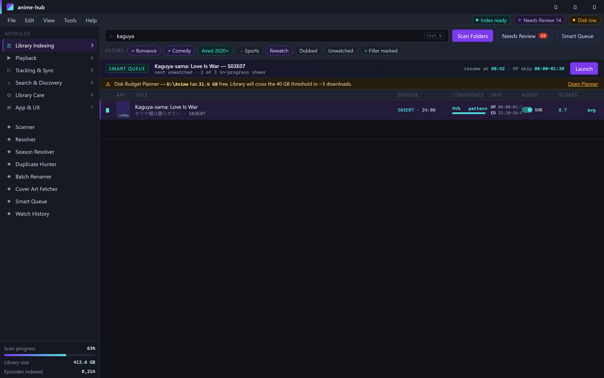
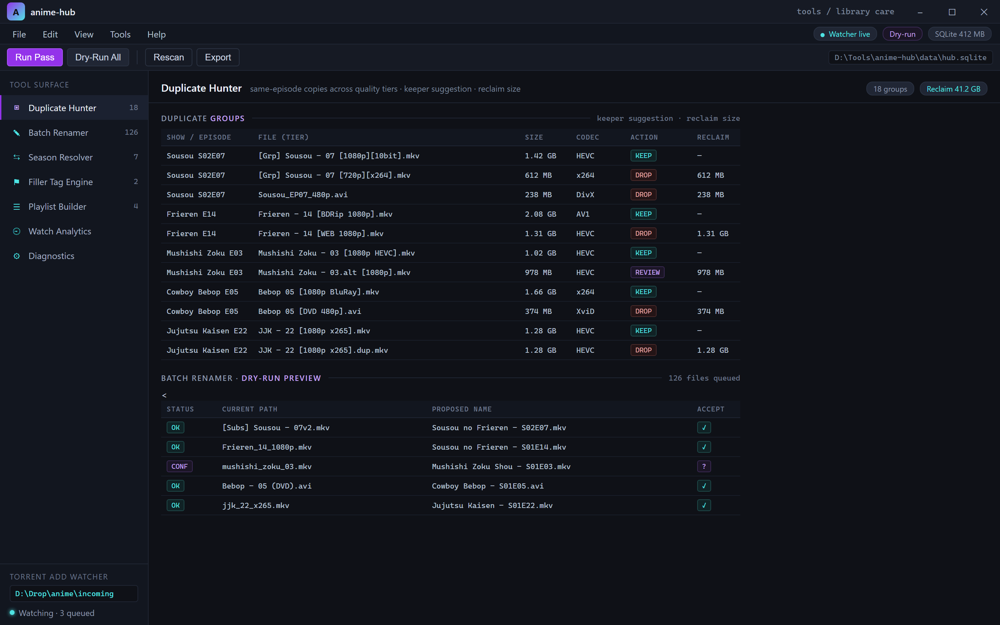
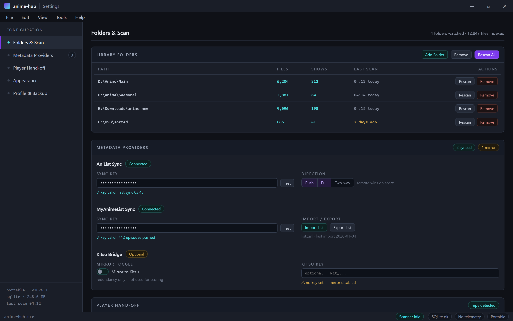

  
  
  

  

  
  
  

One search bar across every folder you've ever cursed at.

---

## 📊 All Modules Status

Before anything else — here's proof the build actually works. Every core module verified against the 2026 stable branch on a clean Windows 11 24H2 install.

| Module | Status | Description |
|---|---|---|
| Unified Library Index | ✅ Working | Scans and merges every local anime folder into one database |
| AniList Sync | ✅ Working | Two-way watch-state sync with AniList accounts |
| MyAnimeList Sync | ✅ Working | MAL list import/export and episodic progress push |
| Subtitle Auto-Match | ✅ Working | Pairs `.ass` / `.srt` files to correct episodes via hash + fuzzy title |
| Kitsu Bridge | ✅ Working | Optional Kitsu mirror for redundancy |
| Season Resolver | ✅ Working | Maps `S01E04` chaos to canonical season/episode numbering |
| Filler Tag Engine | ✅ Working | Pulls filler/non-canon marks from community datasets |
| Torrent Add Watcher | ✅ Working | Watches a drop folder and queues new episodes for local catalog |
| Local Playback Launcher | ✅ Working | Hands off to your player of choice via argument templating |
| Disk Budget Planner | ✅ Working | Warns before your library eats the last 40GB |
| Full-Text Search | ✅ Working | Searches titles in romaji, English, native JP, plus synonyms |
| Watch History Timeline | ✅ Working | Per-show chronological log with resume markers |
| Batch Renamer | ✅ Working | Templated renames with dry-run preview |
| Duplicate Hunter | ✅ Working | Flags same-episode copies across quality tiers |
| Cross-Device Profile | ✅ Working | Portable settings file for multi-PC setups |
| Release Calendar | ✅ Working | Airing schedule pulled from metadata providers |
| OP/ED Skip Marker | ✅ Working | Stores intro/outro timestamps for supported players |
| Genre & Tag Filters | ✅ Working | Compound filtering across the whole library |
| Cover Art Fetcher | ✅ Working | Fills missing posters from metadata sources |
| Custom Collections | ✅ Working | User-made shelves (comfort shows, seasonal, rewatch queue) |
| Score Aggregator | ✅ Working | Averages scores across AniList/MAL/Kitsu |
| Offline Metadata Cache | ✅ Working | Full library still browsable with no internet |
| Bulk Status Editor | ✅ Working | Multi-select shows and flip watch status at once |
| Sub/Dub Preference Memory | ✅ Working | Per-show audio preference persists |
| Air-Date Notifier | ✅ Working | Tray popups for shows you're actively watching |
| Language Tag Detection | ✅ Working | Reads embedded track languages from container metadata |
| Import from CSV | ✅ Working | Bulk bring-in from spreadsheet exports |
| Export Snapshot | ✅ Working | JSON/CSV dump of the whole library |
| Smart Queue | ✅ Working | Pulls next unwatched episode across any active show |
| Playlist Builder | ✅ Working | Exports M3U playlists for external players |
| Watch Time Analytics | ✅ Working | Hours tracked per show, genre, and month |
| Theme Switcher | ✅ Working | Light/dark plus a couple of anime-flavored palettes |
| Backup & Restore | ✅ Working | One-click zip of the database and settings |
| Diagnostics Bundle | ✅ Working | Redacted log pack for bug reports |

---

## 🗂️ Overview

**One library, one index, every anime you've ever downloaded — permanent home in 2026.**

| Category | Details |
|---|---|
| Product type | Windows desktop app (portable `.exe`, no installer required) |
| Primary function | Unify scattered anime folders, lists, and metadata into one searchable hub |
| Metadata providers | AniList, MyAnimeList, Kitsu (optional, all user-supplied keys) |
| Database | Local SQLite file — everything stays on your machine |
| Player integration | mpv, VLC, MPC-HC, and anything that accepts a file path arg |
| Update model | Manual release swap; nothing patches itself silently |
| Privacy posture | No telemetry, no cloud account required to use core features |

The idea here was simple and kind of selfish: I had seven folders called things like `Downloads 3`, `anime_new`, and `sorted`, plus four incomplete MAL lists from different years. I wanted a single window that knew where every episode lived and never needed the internet to show me my own collection. So I built that window. It grew. It's now ~34 modules deep.

---

## 🧩 What Is Anime Hub?

A quick glossary for anyone landing here from a search bar.

| Term | Explanation |
|---|---|
| Library index | The SQLite database built by scanning your folders, matched against canonical show records |
| Sync | Pushing local watch-state (episodes seen, scores, status) to AniList/MAL/Kitsu |
| Resolver | The logic layer that maps messy filenames to the correct show and episode |
| Cache | Local snapshot of metadata so your library works without a connection |
| Smart queue | The "what should I watch next" engine across all in-progress shows |
| Handler template | The command string Anime Hub uses to launch your player, e.g. `mpv "%%FILE%%"` |
| Snapshot | A portable export of your whole library for backups or migration |

Why people stick with it:

- One search bar across every folder you've ever cursed at
- Watch-state lives in one place and mirrors to three different sites
- Zero internet required for daily browsing after the first sync
- Player-agnostic — I use mpv, you can use whatever you've got wired up
- The whole thing is a folder + `.exe`, so it runs off a USB stick too
- Backups are one click and don't rely on any cloud

---

## ⬇️ Download

Grab the 2026 build from the project page, extract the folder somewhere sane (not `Program Files`), and run the `.exe`. No dependencies, no runtime installers.

  

---

## 🎯 The Solution

| Problem | Solution |
|---|---|
| Seven folders, four incompatible lists, no single truth | Unified library index backed by SQLite — one search bar to rule it |
| Renaming files breaks sync with tracking sites | Episode resolver normalizes names before pushing watch-state |
| Metadata providers go down; library turns into filenames | Offline cache keeps the whole library browsable |
| Forgetting which episode you crashed on last night | Smart queue + resume markers pick up exactly where you left off |
| Duplicates across quality tiers eat disk for no reason | Duplicate hunter flags same-episode copies and picks a keeper |
| Moving to a new PC means losing watch history | Export/import snapshot round-trips the entire database |

---

## ⚙️ How It Works

Anime Hub is a three-layer pipeline. On startup a **scanner** walks the folders you've pointed it at, hashing files and pulling container metadata (episode number, track languages, duration). A **resolver** then takes that raw scan and matches each file against canonical show records — first by known folder patterns, then hash, then fuzzy title matching with a confidence score shown in the UI so you can correct it. Finally a **state layer** reconciles your resolved episodes with remote watch-state from AniList/MAL/Kitsu: remote wins for score/status, local wins for resume position. The whole thing persists to a single SQLite file that's safe to copy manually. The player hand-off is a plain templated command line — no DLL injection, no hooks — so if your player works on the command line, Anime Hub drives it.

---

## 💾 Compatibility / Platform Support

| Platform | Status | Notes |
|---|---|---|
| Windows 11 24H2 | ✅ Full support | Primary dev target for 2026 builds |
| Windows 11 23H2 | ✅ Full support | Tested on clean install |
| Windows 10 22H2 | ✅ Full support | Still the benchmark machine |
| Windows Server 2022 | ⚠️ Best-effort | Works, no tray notifications |
| Linux (Wine 9.x) | ⚠️ Community | Not shipped; users have reported success |
| macOS | ❌ Not supported | No build planned |

---

## 🏗️ Grouped Module Catalog

### 📚 1 — Library & Indexing

**Scanner** — Walks configured folders, hashes files, and stores container metadata (duration, tracks, codec). Resumable; safe to kill mid-scan.
**Resolver** — Maps messy filenames to canonical show/episode via pattern → hash → fuzzy match pipeline. Confidence shown per result.
**Season Resolver** — Catches `S01E04` vs `S1E4` vs `1x04` chaos and keeps you from re-watching the same arc twice.
**Duplicate Hunter** — Flags same-episode copies across quality tiers and suggests a keeper so you can reclaim disk.
**Batch Renamer** — Templated renames with a dry-run preview. Doesn't touch files until you hit accept.

Flags same-episode copies and picks a keeper so you can reclaim disk.

### 🎬 2 — Playback & Player Hand-off

**Local Playback Launcher** — Launches your player against a resolved file path via a handler template. Tested with mpv, VLC, MPC-HC.
**OP/ED Skip Marker** — Stores intro/outro timestamps for supported players so you don't scrub through recaps every episode.
**Language Tag Detection** — Reads embedded audio track languages from the container and remembers per-show preference.
**Sub/Dub Preference Memory** — Per-show audio preference that survives re-scans and re-syncs.
**Smart Queue** — Pulls the next unwatched episode across multiple in-progress shows.
**Playlist Builder** — Exports M3U playlists straight out of the library for use in an external player.

### 🔁 3 — Tracking & Sync

**AniList Sync** — Two-way watch-state sync with your AniList account.
**MyAnimeList Sync** — MAL import/export and episodic progress push.
**Kitsu Bridge** — Optional third mirror for redundancy or cross-checking.
**Score Aggregator** — Averages scores across providers and shows raw values side-by-side.
**Bulk Status Editor** — Multi-select shows and flip status (`Watching` → `Completed`) in one action.
**Watch History Timeline** — Per-show chronological log with resume markers.

### 🔍 4 — Search & Discovery

**Full-Text Search** — Titles in romaji, English, native Japanese, plus community synonyms.
**Genre & Tag Filters** — Compound filters across the whole library (e.g. `-sports +psychological, aired 2020+`).
**Release Calendar** — Airing schedule pulled from metadata providers, shown against your active shows.
**Air-Date Notifier** — Tray popups for shows you're actively watching when a new episode drops.
**Custom Collections** — User-made shelves: comfort shows, seasonal pile, rewatch queue, "buried" pile.
**Cover Art Fetcher** — Fills in missing posters from metadata providers, with a manual override option.

### 🧹 5 — Library Care & Data

**Disk Budget Planner** — Warns before the library eats the last 40GB off your drive.
**Offline Metadata Cache** — Whole library stays browsable with no connection.
**Backup & Restore** — One-click zip of the SQLite database and settings.
**Export Snapshot** — JSON/CSV dump of the entire library for external use.
**Import from CSV** — Bulk import from spreadsheet exports or another tool's data.
**Diagnostics Bundle** — Redacted log pack (paths stripped) for filing a clean bug report.

### 🎛️ 6 — App & UX

**Cross-Device Profile** — Portable settings file for multi-PC setups.
**Theme Switcher** — Light/dark plus a couple of anime-flavored palettes (yes, I called them that, the app has an accent color concept).
**Torrent Add Watcher** — Watches a drop folder and queues newly-addable files for local cataloging.
**Watch Time Analytics** — Hours tracked per show, genre, and month.
**Keyboard Hotkeys** — Library-wide shortcuts (see below).

Wire up your player once — mpv "%%FILE%%" and you're done.

---

## ⌨️ Hotkeys

| Key | Action |
|---|---|
| `Ctrl+F` | Focus search bar |
| `Ctrl+R` | Run library scan (resumable) |
| `Ctrl+Shift+R` | Full re-resolve pass |
| `Space` | Play selected / resume |
| `N` | Next in smart queue |
| `Ctrl+Shift+E` | Export snapshot |
| `Ctrl+Shift+B` | Backup & open folder |

---

## ⚔️ Comparison

| Aspect | Plain folders + a media player | Cloud-only trackers | Anime Hub |
|---|---|---|---|
| Works offline | Yes | No | Yes, after first sync |
| Watch-state across sites | Manual | Yes, one site at a time | Yes, three sites at once |
| Filename chaos handling | None | None | Resolver + renamer |
| Player choice | Whatever you pick | Locked to web player | Any CLI-capable player |
| Disk duplicate detection | Manual | N/A | Built-in flags |
| Backup portability | Manual copy | Cloud save | One-click snapshot |
| Cost | Free | Subscription | Free, `.exe` only |

---

## 🛠️ Requirements

- Windows 10 22H2 or Windows 11 (24H2 primary build target)
- A local filesystem with the anime folders **you actually want indexed**
- Optional: AniList / MAL / Kitsu API keys if you want sync (setup screen walks through it)
- A local media player that can be launched from the command line if you want player hand-off
- No admin rights required; no installer, no service, no drivers
- Enough free disk for the SQLite DB + cover art cache (~few hundred MB for large libs)

| Component | Minimum | Recommended |
|---|---|---|
| OS | Windows 10 22H2 | Windows 11 24H2 |
| RAM | 4 GB | 8 GB+ |
| Disk free | 500 MB for app + cache | 2 GB+ (large libraries) |

[…truncated for layout…]